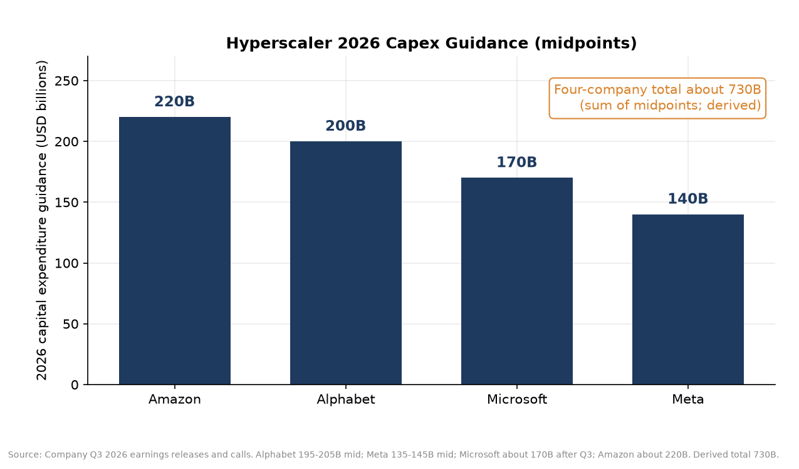
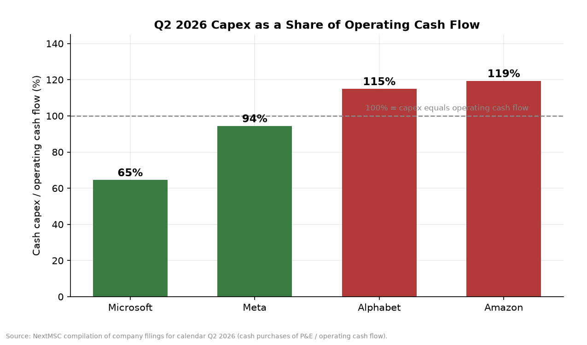
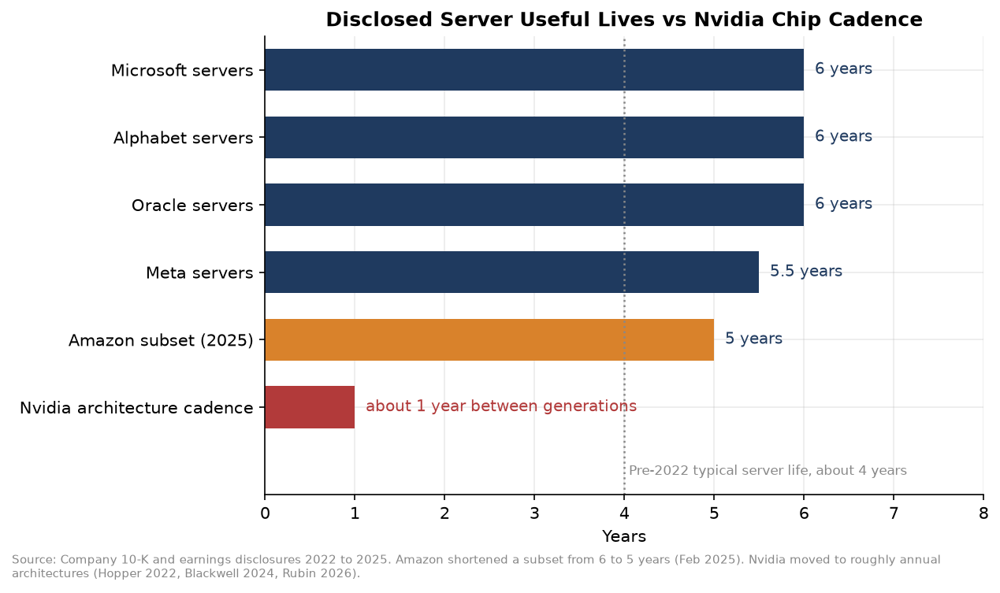
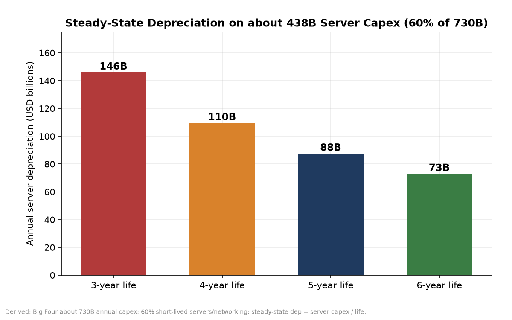
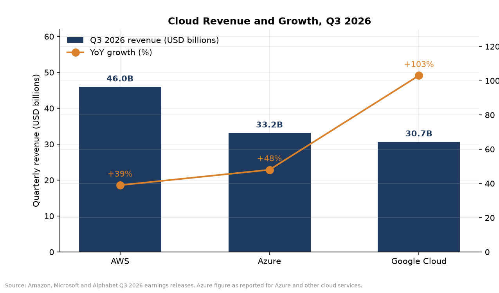
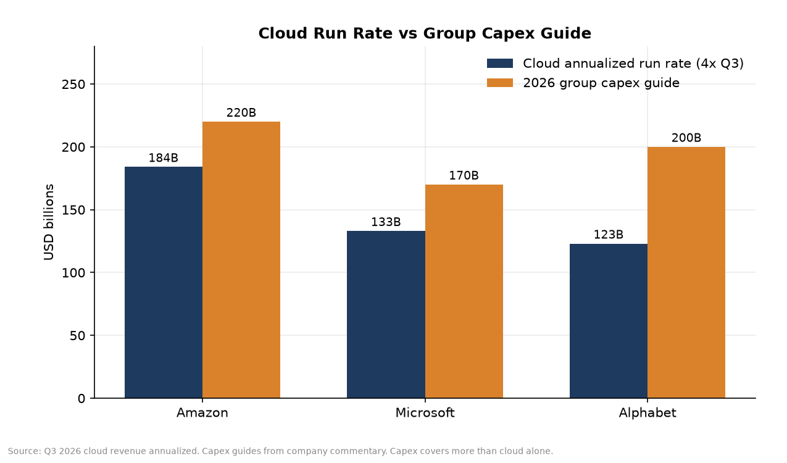
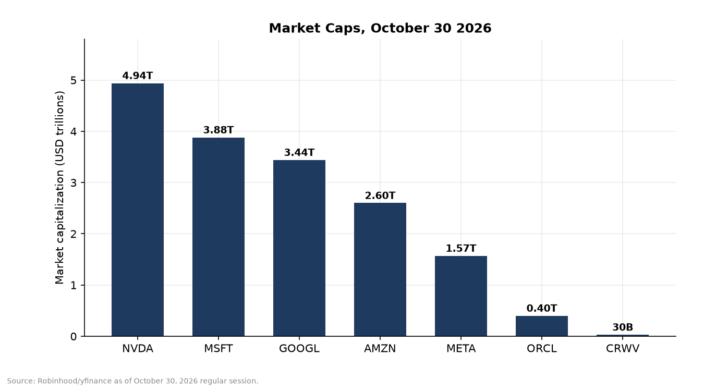
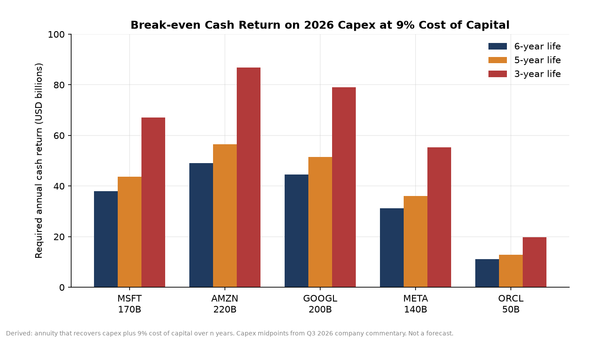

# Assigned Lives: Depreciation Schedules, Data Center Capex and What Prices Require

The largest technology companies are spending on data centers and AI accelerators at a pace that would have looked implausible a few years ago. The four U.S. hyperscalers that dominate cloud and digital advertising, Amazon, Alphabet, Microsoft and Meta, are guiding to about $730 billion of capital expenditure in calendar 2026. Oracle and specialists such as CoreWeave add still more. Nvidia, which sells much of the silicon that fills those buildings, carries a market value near $5 trillion.

Investors who own these stocks are underwriting two linked claims. The first is that the useful lives assigned to servers and GPUs in the footnotes are close enough to economic reality that reported earnings are a fair guide to cash generation. The second is that the revenue, margins and returns on the new capital will be high enough, for long enough, to justify today's prices. This article lays out what the filings and the latest quarter show, what a shorter useful life would do to depreciation, and what growth and returns current prices appear to require. Derived calculations are labelled as such. None of this is a forecast of what will happen, only a reading of what the numbers imply.

## The size of the build

In the September 2026 quarter the same four hyperscalers spent about $207 billion on capital expenditure. Amazon's cash purchases of property and equipment were in the mid $70 billions. Alphabet recorded $51.4 billion of purchases of property and equipment. Microsoft spent $45.2 billion including finance leases. Meta spent $34.9 billion on a company defined basis.

The 2026 guides remain elevated even after that quarter. Amazon left its cash capex target at about $220 billion and said 2027 would be meaningfully higher. Alphabet held a range of $195 to $205 billion and said 2027 would increase significantly. Microsoft trimmed its calendar 2026 figure to about $170 billion from roughly $175 billion, citing delayed third party capacity and a shift of more leases toward operating classification, which sits outside reported capex. Meta raised the floor of its range to $135 to $145 billion. Summing the midpoints of those four guides gives about $730 billion for the year. That total is derived from company commentary and should be read with the usual caveat that capex definitions are not identical across firms.

Capex is now large relative to the cash the businesses throw off. In the second quarter of 2026, cash purchases of property and equipment were 119% of operating cash flow at Amazon, 115% at Alphabet, 94% at Meta and 65% at Microsoft. Free cash flow turned sharply negative at Amazon on a trailing twelve month basis, at an outflow of $42.4 billion through September. Alphabet and Meta reported negative free cash flow in the September quarter. Microsoft still generated positive free cash flow, but the figure fell year over year as spending rose.

Spending ahead of cash flow is not automatically a problem if the assets earn high returns. It does mean that the valuation debate is no longer only about multiples on today's earnings. It is about whether the capital being put in the ground will earn more than it costs, over the lives that actually matter.

## What useful life means

Under U.S. GAAP, a company depreciates property and equipment over an estimated useful life. Lengthen that life and annual depreciation falls, which raises reported operating income. Shorten it and the opposite occurs. Cash spending is unchanged in the period of purchase. What changes is the timing of expense recognition and therefore the earnings investors often treat as a proxy for economic profit.

Between 2022 and early 2025, several hyperscalers extended those lives. Microsoft moved cloud server and network equipment from four years to six, and disclosed a FY2023 benefit of about $3.7 billion. Alphabet moved servers and certain network equipment from four years to six after a lifecycle assessment, with a disclosed FY2023 depreciation reduction of about $3.4 billion. Meta stepped through several extensions and, effective late January 2025, to five and a half years, with a disclosed 2025 depreciation reduction of about $2.9 billion. Oracle has also moved onto a longer schedule, now described in commentary as six years for servers and networking.

Amazon then broke ranks. Effective January 1, 2025, it shortened the useful life of a subset of servers and networking equipment from six years back to five, citing the increased pace of technology development in artificial intelligence and machine learning. It also recorded about $920 million of accelerated depreciation in the fourth quarter of 2024 for equipment retired early. The 2025 operating income hit from the life change was disclosed at about $0.7 billion.

The companies are largely buying the same class of accelerators and networking gear. Divergent book lives for similar assets are therefore a signal worth watching, not a curiosity of accounting policy. Longer lives may be justified by cascading use, where a GPU leaves frontier training and continues to earn in inference or lower priority work. Shorter lives may be justified by power, cooling and performance gaps that strand older silicon even when it still runs. Both stories can be true for different parts of a fleet. The question for valuation is which story dominates the dollars.

## Chip cadence and the obsolescence clock

Nvidia has shifted from a roughly two year architecture cycle toward an annual one. Hopper systems arrived in volume around 2022 and 2023. Blackwell followed in 2024. Blackwell Ultra products were positioned for 2025. Vera Rubin systems are expected in the second half of 2026, with further steps on the published roadmap after that. Each generation is marketed as a large improvement in performance per watt and per dollar of capital.

If customers refresh to capture those gains, economic life can be shorter than physical life. If software improvements and secondary workloads keep older GPUs fully utilized at acceptable margins, book lives of five or six years can be conservative. Nvidia has argued publicly that CUDA compatibility and software advances keep prior generations productive for years, pointing to Ampere generation GPUs still running at high utilization. CoreWeave has described customer contracts that rebook older capacity at high percentages of prior prices and, in at least one case, extend Ampere era capacity deep into the decade.

Michael Burry took the opposite side in November 2025. He argued that extending useful lives while buying chips on a two to three year product cycle understated depreciation, and estimated about $176 billion of understatement across 2026 to 2028. He suggested Oracle and Meta were among the more exposed names on an earnings percentage basis. Independent reconstructions that start from a four year counterfactual closer to pre 2022 policy have produced cumulative figures in a similar neighborhood, on the order of $200 billion through 2028, with annual effects rising as the longer lived fleet compounds. Those reconstructions are third party estimates built on disclosed schedules and projected capex. They are not audited restatements.

## A simple depreciation sensitivity

A transparent way to see the stakes is to hold the spending fixed and change only the life assumption. Take the Big Four's combined 2026 midpoint of about $730 billion. Assume, following industry analyses of the share of spend that is servers, GPUs and networking rather than buildings and land, that about 60% is short lived equipment. That is about $438 billion of server like capital if the guides are met.

In steady state, if that pace continued, annual depreciation on the server like portion alone would be about $73 billion at a six year life and about $146 billion at a three year life. The difference, about $73 billion a year, is derived arithmetic, not a company disclosure. It would flow straight into operating income if lives were restated, with no change in cash capex. A one year cohort alone, moved from six years to three, would add about $73 billion of annual depreciation for that cohort across the four firms while that cohort remains on the books.

Burry's published framing that Oracle's and Meta's earnings could be overstated by roughly 27% and 21% by 2028 under his scenario is a company level claim about the path of spending and lives. Applying those percentages mechanically to the latest full year net income figures would cut Oracle's FY2026 net income from about $17.1 billion toward roughly $12.5 billion and Meta's 2025 net income from about $60.5 billion toward roughly $48 billion, which would lift trailing price to earnings multiples accordingly. That arithmetic is illustrative. It inherits every assumption in the original scenario and should not be confused with a restatement.

## Cloud growth is real, and still has to clear a high bar

The demand side of the story is not empty. In the September 2026 quarter, AWS revenue was $46.0 billion, up 39%, with operating income of $17.8 billion and an annualized run rate of about $184 billion. Azure and other cloud services revenue was $33.17 billion, up 48%. Google Cloud revenue was $30.7 billion, up 103%, with operating income of $11.1 billion. Contracted backlogs are large: Microsoft's commercial remaining performance obligation was about $677 billion, Amazon pointed to unrecognized performance obligations around $578 billion concentrated in AWS, and Google Cloud backlog commentary clustered near $560 billion. Definitions differ, and backlog is not cash.

Even so, group capex guides sit close to, or above, today's cloud run rates at Amazon and Alphabet, and Meta has no external cloud segment at all. Capex also funds logistics, offices and non AI infrastructure, so a dollar of group capex is not a dollar of AI servers. The comparison is still a reminder that monetization has to scale with the build. Amazon has said that servers and networking break even in a little under three years on its economics and that much AI capacity is contracted on multi year terms before servers are purchased. If that payback holds at the margin as the mix shifts further into AI, the cash case can work even when reported depreciation is debated. If payback lengthens because prices for compute fall faster than costs, or because utilization disappoints, both the accounting debate and the valuation debate tighten at once.

## What prices appear to require

As of the October 30, 2026 regular session, market capitalizations were about $4.94 trillion for Nvidia, $3.88 trillion for Microsoft, $3.44 trillion for Alphabet, $2.60 trillion for Amazon, $1.57 trillion for Meta, $0.40 trillion for Oracle and $30 billion for CoreWeave. Trailing earnings yields on the profitable names clustered between about 3.7% and 6.9%, still below a 9% illustrative cost of capital for mature technology businesses. Prices therefore embed substantial growth, margin expansion, or both.

One way to turn that into an operating test is to ask what cash return the 2026 capex wave must earn to break even economically. Treat each year's capex as a project that must recover capital and a 9% cost of capital over its useful life. The annuity payment that does that is about 22% of the capital outlay per year over six years, about 26% over five years, and about 40% over three years. On Amazon's $220 billion guide, that is roughly $49 billion a year of cash return over six years versus roughly $87 billion a year over three years. On Microsoft's $170 billion, the figures are about $38 billion versus $67 billion. On Alphabet's $200 billion midpoint, about $45 billion versus $79 billion. On Meta's $140 billion midpoint, about $31 billion versus $55 billion. These are derived break even hurdles, not management targets.

A second lens is a simple two stage reverse discounted cash flow on free cash flow. Using fiscal 2026 free cash flow of about $67 billion for Microsoft, a 9% discount rate, ten years of high growth and 3.5% growth thereafter, the enterprise value near $3.95 trillion is consistent with free cash flow growth on the order of 18% a year during the high growth window. Nvidia's fiscal 2026 free cash flow of about $97 billion against an enterprise value near $4.9 trillion is consistent with high single teens free cash flow growth on the same template. Both results are sensitive to the starting free cash flow. For companies that are deliberately depressing free cash flow with growth capex, a reverse DCF on today's free cash flow overstates the growth needed once reinvestment normalizes. The more durable question is the return on the incremental capital, not the temporary free cash flow identity.

A third lens is incremental AI or cloud profit. Suppose incremental AI related operating margins after tax land near 20% to 30%, a wide band that brackets parts of today's cloud profitability and leaves room for price pressure. Then each $50 billion of required annual cash return implies on the order of $170 billion to $250 billion of incremental annual revenue once the assets are mature, before counting the revenue already in the run rate. Scaling that thought across hundreds of billions of annual capex shows why investors focus on whether cloud growth stays near recent rates and whether AI products attach high incremental margins. The arithmetic is intentionally coarse. Its purpose is to make the market's implied hurdle visible, not to produce a false precision forecast.

## Circular financing and concentration risk

Part of the demand that supports the build is financed in ways that deserve a separate line in any checklist. Nvidia has held equity stakes and capacity arrangements with GPU cloud providers such as CoreWeave, whose revenue has been concentrated with a small number of hyperscaler customers. Large compute commitments involving OpenAI, Oracle and Nvidia have been reported at very large notional amounts, alongside commentary that some equity investment letters of intent were not yet definitive agreements. Vendor and customer financing can be ordinary in a capacity constrained industry. It can also create correlated exposures if equity funding for the buyers thins out, if secondary GPU prices fall, or if contracted utilization fails to convert to cash on the expected schedule. Historical analogs in telecom equipment around 2000 are imperfect, but they are the reason concentration and financing terms belong next to depreciation policy in any reading of the cycle.

## How to use this without pretending to omniscience

Useful life policy is a judgment, not a binary fraud test. Auditors review whether management's documentation is consistent. Cascading workloads and multi year take or pay contracts can support longer lives. Amazon's subset reversal and early retirement charge cut the other way for at least part of the AI fleet. Capex guides can rise because of higher component prices rather than more installed capacity, which makes dollar growth a noisy proxy for compute growth. Backlogs can slip. Reverse DCF outputs move with the cost of capital and with the choice of starting cash flow.

What does not move is the structure of the bet. Hundreds of billions of dollars a year are being capitalized into assets whose economic life is contested. Reported earnings are higher when those lives are longer. Stock prices at current levels need the assets to earn mid twenties percent or higher cash returns if lives are near six years, and closer to forty percent if lives are near three, on the simple break even math above, unless terminal values and growth do more of the work. Cloud revenue growth in the latest quarter is strong enough to keep that bet live. Free cash flow is weak enough to keep the financing and payback questions live as well.

The practical habit is therefore simple. Read the useful life footnote every reporting season. Compare depreciation to capex and to cash from operations. Separate building lives from server lives. Translate the stock price into a required return on the new capital under short and long life assumptions. And treat any gap between chip cadence and book life as a risk factor to monitor, not as a settled fact either for the bulls or for the bears.

## Sources

1. Amazon.com Q3 2026 earnings release: AWS revenue, operating income, free cash flow, capex commentary.
2. Microsoft Q1 FY2027 (quarter ended September 30, 2026) earnings materials: Azure growth, commercial RPO, capex including finance leases, calendar 2026 capex commentary.
3. Alphabet Q3 2026 earnings materials: Google Cloud revenue and operating income, purchases of property and equipment, 2026 capex range.
4. Meta Q3 2026 earnings materials: company defined capex, free cash flow, 2026 capex range.
5. Oracle FY2026 results: revenue, operating income, capital expenditure.
6. Company useful life disclosures: Microsoft FY2022/FY2023 commentary on 4 to 6 year extension; Alphabet January 2023 lifecycle assessment; Meta January 2025 extension to 5.5 years; Amazon February 2025 shortening of a subset from 6 to 5 years and Q4 2024 accelerated depreciation.
7. CNBC reporting (November 11 and November 20 to 25, 2025) on Michael Burry's depreciation critique and Nvidia's response.
8. Nvidia GTC and earnings commentary on annual architecture cadence (Hopper, Blackwell, Vera Rubin).
9. NextMSC hyperscaler capex comparison (data cut off October 18, 2026) for Q2 2026 cash capex versus operating cash flow ratios.
10. Market prices and capitalizations: Robinhood and yfinance as of the October 30, 2026 regular session.
11. Derived calculations in this article: combined $730 billion midpoint; 60% server share; steady state depreciation by life; break even annuity returns at 9% cost of capital; illustrative reverse DCF growth rates; mechanical application of Burry percentage overstatement to recent net income.

## Caveats

Figures labelled derived are arithmetic on cited inputs and are not company guidance. Capex definitions differ across firms. Useful life estimates are management judgments under GAAP. Cloud backlog is contracted revenue, not cash. Free cash flow is currently depressed by design at several firms, which limits reverse DCF precision. Component price inflation can raise capex dollars without raising installed compute one for one. Nothing here is investment advice.
